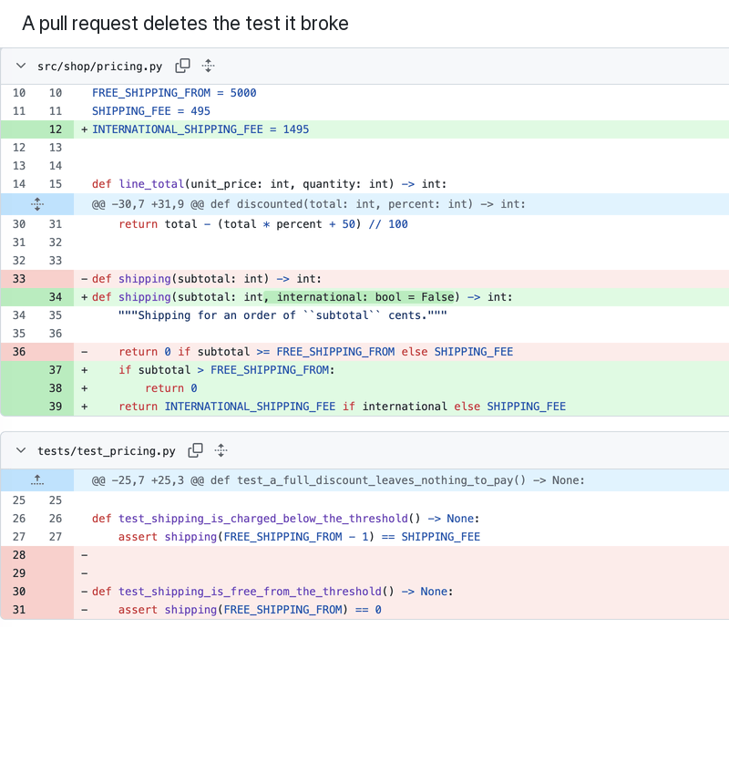

# honest-ci

honest-ci is a GitHub Action that notices when a pull request gets its tests to
pass by deleting, skipping or rewriting them, and holds that pull request for a
person, with the evidence.



About one pull request in eleven deletes a test, skips one, takes out
assertions or changes an expected value. That held for coding agents and for
people alike, in [2,717 pull requests on public repositories](https://honest-ci.dev/articles/coding-agents-weaken-tests),
and nearly every one had a reason: the feature went out with its tests, or the
expected value really changed. About one in 250 weakened a test and gave no
reason. CI can't tell the two apart, because the suite passes either way.
honest-ci reads the diff, sees which test went away or changed and how, and
asks a person to look before the change is merged.

It decides from the diff alone, with deterministic code: no model, no Docker
and no test setup are needed for a first install. A model can be added to
explain and to read rules that code can't, but it never decides.

honest-ci is source-available under the [Fair Core License](LICENSE)
(FCL-1.0-ALv2). It is free on public repositories and on your own private
ones; a team's private repository needs a subscription after a 14-day trial.
See [License](#license).

- [What it checks](#what-it-checks)
- [Install it on GitHub](#install-it-on-github)
- [Try it locally](#try-it-locally)
- [What a pull request shows](#what-a-pull-request-shows)
- [Letting a held pull request through](#letting-a-held-pull-request-through)
- [Which pull requests it runs on](#which-pull-requests-it-runs-on)
- [What it protects against, and what it doesn't](#what-it-protects-against-and-what-it-doesnt)
- [Why the model never decides](#why-the-model-never-decides)
- [The evidence pack and the fingerprint](#the-evidence-pack-and-the-fingerprint)
- [Privacy](#privacy)
- [Configuration](#configuration)
- [Pricing](#pricing)
- [Help setting it up](#help-setting-it-up)
- [License](#license)

## What it checks

Five test-integrity rules, one per check. They read the lines a pull request
removes as well as the ones it adds: deleting the failing test leaves no added
line to find.

| Rule | Check | A hit is | By default |
|---|---|---|---|
| `I-01` | `deleted_test` | A test, a named case of a test table, or a whole test file stops existing or stops being collected, and nothing of that name is added back where the runner collects it. Moving or renaming a test is not a deletion. | Held for a person |
| `I-02` | `skip_or_focus` | A new skip, xfail, todo or focus marker: `@pytest.mark.skip`, `unittest.skip`, `it.skip`, `xit`, `test.todo`, `.only`, `fit`, `@Disabled`, `@Ignore`, `t.Skip()` and the like. A marker in a comment or a string does not count. | Held for a person |
| `I-03` | `fewer_assertions` | A test file that stays loses more assertions than it gains. | Held for a person |
| `I-04` | `changed_expectation` | An assertion or expected value keeps its shape and changes only a literal, in a pull request that also edits code outside the tests. | Held for a person |
| `I-05` | `loosened_threshold` | A coverage threshold lowered or removed, or tests left out of the run: `--ignore`, `-k "not ..."`, a narrower `testpaths`, `testPathIgnorePatterns`, `-DskipTests`, `\|\| true` after a test command, and the like. | Blocked |

The checks know Python, JavaScript and TypeScript, Java and Go test files.

A hit is a fact about the diff, and it is worded that way. Removing a feature
together with its tests is an `I-01` hit exactly as deleting the test that
fails is, and an expected value can change because the old one was wrong. The
diff can't tell these apart, so the first four hold the pull request for a
person instead of blocking it. The comment says which test changed and how,
and the person decides. `I-05` blocks: a lower bar changes what passing means
for every pull request after this one. Each rule's `action` can be set to
`block`, `needs_human` or `record`.

Beside the test-integrity rules:

- **Your team's rules.** A regular expression matched on the lines a pull
  request adds, or a path whose change is the finding. `honest-ci init
  --github` writes commented-out examples of both.
- **Sensitive paths and size.** A pull request that touches `.github/`,
  migrations, infrastructure, auth, security or payment code, or honest-ci's
  own two configuration files, goes to a person. So does one past 60 files or
  4000 lines. The paths and the limits are yours to edit, in the policy file.
- **Unresolved review threads.** While a review thread on the pull request is
  unresolved, it waits for a person: somebody asked a question and nobody has
  answered it.

[bench/](bench/README.md) measures how often these checks fire on pull
requests that coding agents opened in public repositories, next to pull
requests people opened in the same repositories at the same time. On 2,717
pull requests from July and August 2026, a person decided the label of every
flag, one at a time, and 93.6% of the flags were true statements about the
diff. [Every label](bench/data/README.md) is published, with its reason and a
link to the line.

## Install it on GitHub

At the root of your repository:

```bash
pipx run --spec git+https://github.com/ChrisShips/honest-ci@v0.1.0 honest-ci init --github
```

It writes three files, and leaves alone any that already exist:

- `.github/workflows/honest-ci.yml` runs the Action on every pull request. It
  turns the regression gate off, so that a first install needs no Docker and no
  test setup.
- `honest-ci-rules.toml` holds the five test-integrity rules and
  commented-out examples of rules of your own.
- `honest-ci-policy.toml` requires the review gate and nothing else, and lists
  the sensitive paths.

Without pipx, copy the same three files from
[src/honest_ci/resources/](src/honest_ci/resources/): `github-workflow.yml` to
`.github/workflows/honest-ci.yml`, and the two TOML files to the repository
root.

Then:

1. **Commit the three files and open a pull request with them. That first pull
   request goes to a person, and it should.** The Action reads the rules and
   the policy at the pull request's base commit, which has neither yet, and the
   pull request changes `.github/`. Review it and merge it. Every pull request
   after it is judged by the files it merged.
2. **Make the verdict a merge requirement.** In the branch protection rule or
   ruleset for your default branch, require the status check
   `honest-ci/verify`. GitHub offers a check here only once it has reported
   in the past week, which it did on the first pull request. On a private
   repository, branch protection and rulesets need a paid plan.
3. **Protect the configuration.** See
   [What it protects against](#what-it-protects-against-and-what-it-doesnt):
   a `CODEOWNERS` entry for `.github/` and `honest-ci-*.toml`.

This is the whole workflow it installs:

```yaml
# Verifies every pull request with honest-ci and reports back on it: one
# comment with the conclusion, and a commit status named honest-ci/verify.
# To make the verdict a merge requirement, add honest-ci/verify to the
# required status checks of the branch's protection rule.
name: honest-ci

# pull_request, never pull_request_target. honest-ci checks out and scans the
# pull request's own code, and pull_request_target would do that with a token
# that can write to this repository and with its secrets. On pull_request a
# fork's run gets a read-only token, so honest-ci writes the verdict to the
# job summary instead of the pull request.
#
# pull_request_review is how a person lets through a change that honest-ci
# hands to one: an Approve review on the head commit, with the reason in its
# text, from someone who can push. The run it starts verifies the pull request
# again and counts the approval. A dismissed review starts one too, so an
# approval that is taken back stops counting.
on:
  pull_request:
  pull_request_review:
    types:
      - submitted
      - dismissed

# What honest-ci uses, and nothing else.
permissions:
  contents: read  # check the code out and read the pull request
  pull-requests: write  # post and update the conclusion comment
  statuses: write  # set the honest-ci/verify commit status

# A push to the pull request cancels the run for the commit it replaced.
concurrency:
  group: ${{ github.workflow }}-${{ github.event.pull_request.number }}
  cancel-in-progress: true

jobs:
  run:
    runs-on: ubuntu-latest
    steps:
      # The pull request's head commit: by default a pull_request run checks
      # out a merge commit that is nowhere in the pull request. The whole
      # history, because honest-ci reads the rules and the policy at the base
      # commit. And no credential left in the checkout, where the pull
      # request's own code could read it.
      - uses: actions/checkout@3d3c42e5aac5ba805825da76410c181273ba90b1 # v7.0.1
        with:
          ref: ${{ github.event.pull_request.head.sha }}
          fetch-depth: 0
          persist-credentials: false

      # Pinned to a release tag. For a pin nobody can move, replace the tag
      # with the commit SHA it points to.
      - uses: ChrisShips/honest-ci@v0.1.0
        with:
          # Needed on an organization's private or internal repository, and on
          # a personal account's private one where other people open pull
          # requests, after a 14-day trial. Save the key as an organization
          # secret on GitHub Team or Enterprise. Save it as a repository secret
          # on GitHub Free, which doesn't pass organization secrets to private
          # repositories, and under a personal account, which has no
          # account-wide secrets. If Dependabot opens pull requests, save it as
          # a Dependabot secret too, at the same level, since the runs it
          # starts get no other secrets. Anywhere else, leave the secret unset:
          # no key is asked for.
          license-key: ${{ secrets.HONEST_CI_LICENSE_KEY }}
        env:
          # The regression gate runs the test suite in a Docker sandbox. It is
          # off here so that a first install needs no test setup. To turn it
          # on, delete this line; to require it, also list "regression" in
          # required_checks in honest-ci-policy.toml.
          HONEST_CI_DISABLED_GATES: regression
```

[examples/python-agent-demo](examples/python-agent-demo/README.md) is a small
shop whose tests an agent weakens in three ways. Its
[GITHUB.md](examples/python-agent-demo/GITHUB.md) builds a repository from it to
try the Action on, and says what each pull request there should show.

## Try it locally

`honest-ci verify` runs the same checks on the changes in a git working tree,
before there is a pull request. With pipx and Python 3.11 or later:

```bash
pipx install git+https://github.com/ChrisShips/honest-ci@v0.1.0
```

The Python demo is the quickest way to see it catch something. In its
`delete-failing-test` scenario, an agent's change breaks the free-shipping test,
and the agent deletes the test:

```bash
git clone --depth 1 --branch v0.1.0 https://github.com/ChrisShips/honest-ci
cp -r honest-ci/examples/python-agent-demo /tmp/honest-ci-demo && cd /tmp/honest-ci-demo && git init -q && git add -A && git commit -qm baseline
export HONEST_CI_DISABLED_GATES=regression
git apply scenarios/delete-failing-test.patch && honest-ci verify; echo "exit code $?"
```

`HONEST_CI_DISABLED_GATES=regression` turns off the gate that runs the tests in
Docker, as the GitHub workflow does. `honest-ci verify` judges the working tree
against `HEAD`. It names the deleted test and exits with code 3: the change
waits for a person. It also writes an evidence pack under
`.honest-ci/artifacts/`, and `evidence.md` there is the readable version. The
demo's [README](examples/python-agent-demo/README.md#run-it) has the other three
scenarios and how to reset the tree between them.

## What a pull request shows

One comment, edited in place on every run; one commit status,
`honest-ci/verify`, on the head commit; and one job, whose exit code is the
verdict.

| Verdict | Comment heading | `honest-ci/verify` | Exit code |
|---|---|---|---|
| Nothing stops it | `honest-ci · mergeable` | `success` | 0 |
| Held for a person | `honest-ci · awaiting_human` | `pending` | 3 |
| Held, then approved | `honest-ci · approved` | `success` | 0 |
| Blocked | `honest-ci · blocked` | `failure` | 1 |
| The run failed | `honest-ci · failed` | `error` | 4 |
| No gate ran: no license key that works | `honest-ci · not run` | `error` | 4 |

The exit code is also 4 when the comment or the status could not be written:
the verdict is in the evidence pack, but nobody on the pull request can see it.

Where honest-ci needs a license key (see [License](#license)), no gate runs
without one once the 14-day trial is over, or with one that is refused or more
than 30 days past its expiry date. A trial key has no such days: it stops the
day after its expiry date. The comment says nothing about the change, which
nothing checked: it says why this repository needs a key and why the run
stopped, and how to get a key, set it, or stop running honest-ci. During a
trial, the one in GitHub Actions or one on a trial key, and in the 30 days
after a key's expiry date, every comment ends with how many days are left. In
other CI systems there is no automatic trial: without a key,
`honest-ci run-pr` posts the same comment and status, `honest-ci verify` and
`honest-ci resume` say it in their output, all three exit with code 4, and a
14-day trial key is an [email](mailto:support@honest-ci.dev) away.

A pull request held for a person gets `pending`, not `failure`. With the check
required, `pending` keeps the merge button locked, which is the right reading of
"nobody has verified this yet". Only a verdict of mergeable, or an approval,
turns it green.

The comment on the `delete-failing-test` scenario of the demo reads, in part:

```markdown
## honest-ci · awaiting_human

**This change needs a human review. To approve it, submit an Approve review on this pull request and write the reason in the review's text.**

### Test integrity (1)

- **[I-01] Tests do not disappear** · needs a human · `tests/test_pricing.py`:30 (base)
  - Test `test_shipping_is_free_from_the_threshold` is removed, and no test by that name is added back in this change.
  - Removed: `def test_shipping_is_free_from_the_threshold() -> None:`
  - Suggested fix: Keep the test, or say in the pull request why it no longer applies.

### What this run could not verify

- Gates recorded as skipped: spec. Not deployed or switched off, which is not a pass.
```

"What this run could not verify" is in every comment. A gate that was switched
off, a scanner that did not run or a file with nothing to review is listed
there, and never counted as a pass.

## Letting a held pull request through

Submit an **Approve** review on the pull request, with the reason in the
review's text. The review starts a run of its own, which verifies the pull
request again and counts the approval. It counts when all of these hold:

- a person gave it, not a bot, and that person can push to the repository;
- it was given on the head commit, after honest-ci's comment for that commit
  went up;
- its text gives a reason;
- nobody who can push has a request for changes standing.

It counts for that commit, and for the rules and the policy of that run, only.
A new commit, or a new version of the rules or the policy, needs a new
approval. A blocked pull request can't be approved: it is fixed with a new
commit.

GitHub doesn't let the author of a pull request approve it, nor the person who
asked Copilot's cloud agent for it. Several agents can open pull requests under
the account of the person who started them; for those, too, somebody else who
can push has to approve.

The comment names the approver, links the review and quotes the reason, and
the evidence pack keeps the decision as `approval.json`. Approvals that did not
count are listed in the comment with the reason.

## Which pull requests it runs on

The workflow runs on `pull_request` and `pull_request_review`. Whether GitHub
starts it for a pull request depends on who opened it. As GitHub's and the
agents' documentation stood in September 2026:

| Opened by | Does the workflow run? |
|---|---|
| A person, from a branch in the repository | Yes. |
| A person, from a fork | Yes, with a read-only token ([forks](#pull-requests-from-forks)). Depending on the repository's [setting for outside contributors](https://docs.github.com/en/actions/how-tos/manage-workflow-runs/approve-runs-from-forks), GitHub may hold the run until someone with write access approves it. |
| GitHub Copilot's cloud agent | Not until someone with write access clicks **Approve and run workflows** on the pull request. An admin can turn that off: Settings → Copilot → Cloud agent, **Require approval for workflow runs** ([docs](https://docs.github.com/en/copilot/how-tos/use-copilot-agents/cloud-agent/configuring-agent-settings)). |
| A workflow, with the job's `GITHUB_TOKEN` | Not until someone with write access approves the run on the pull request. A GitHub App token or a personal access token runs it without approval ([docs](https://docs.github.com/en/actions/concepts/security/github_token)). |
| Claude Code's GitHub Action | Yes: by default it pushes as the Claude GitHub App. Given `github_token: ${{ secrets.GITHUB_TOKEN }}`, its pushes are the row above ([docs](https://code.claude.com/docs/en/github-actions)). |
| OpenAI Codex, Google Jules, Cursor, Devin | Their documentation doesn't say. Open one pull request with the agent and check that honest-ci ran before you rely on it. |

While a run waits for approval, the pull request has no `honest-ci/verify`
status. With the check required, it can't be merged until someone approves the
run and honest-ci reaches a verdict.

## What it protects against, and what it doesn't

honest-ci guards against a coding agent taking the short way to a green check,
and against honest mistakes. It does not guard against whoever can push to the
repository and edits the workflow to get around it, person or agent.

A pull request runs the workflow as the pull request has it. So a pull request
that edits `.github/workflows/honest-ci.yml` can skip honest-ci, or set
`honest-ci/verify` to `success` itself. honest-ci reads its rules and its
policy at the base commit, so a pull request can't loosen the rules it is
judged by, and a pull request that touches `.github/` or `honest-ci-*.toml` goes
to a person. But the workflow that reports that is the pull request's own.

Close that gap with code owners. Add a `CODEOWNERS` file:

```text
/.github/            @your-org/maintainers
/honest-ci-*.toml    @your-org/maintainers
```

and turn on **Require review from Code Owners** in the branch protection rule
or ruleset. A change to the workflow or the configuration then needs a code
owner's review whatever honest-ci says. On GitHub Free this is available for
public repositories only. Anyone allowed to bypass branch protection can still
merge anything.

With the regression gate on, your tests run in a Docker container with the
network off. Only the dependency install step gets the network. No credential
goes into the container.

### Pull requests from forks

- A fork's run gets a read-only token, so honest-ci can't comment or set a
  status. It writes the verdict to the job summary instead, and the job still
  ends with the verdict's exit code.
- No approval can count on a fork's pull request: every run for it gets a
  read-only token, and the approval needs the window honest-ci's comment
  records.
- So with `honest-ci/verify` required, a pull request from a fork can't be
  merged unless someone bypasses the rule. If your repository takes pull
  requests from forks, weigh that before you make the check required.
- `pull_request_target` is refused. It would run the pull request's code with
  a token that can write to your repository and with its secrets.

## Why the model never decides

A verdict decides what gets merged, and a person has to be able to say why it
came out the way it did. So every verdict is decided by deterministic code,
from the diff, the rules, the policy and the test results, and the evidence
pack says which rule or which test decided it.

The model is off until you name one. Once on, it does four things, each on a
short leash:

- It explains why a change was blocked. The explanation has to cite evidence
  the gates produced, and anything it can't cite is discarded whole.
- It reads judgment rules, the ones that can't be written as a pattern, such
  as "a new endpoint must be idempotent". What it finds has to name a rule in
  your rules file and point at a line the pull request adds; otherwise the
  whole answer is discarded. A finding it keeps sends the pull request to a
  person. It never blocks.
- When a pull request goes to a person, it writes that person a reading aid,
  under the same citation checks.
- With the regression gate on, it proposes regression tests for the code the
  change touched. They run once, apart from your own tests, and are deleted
  afterwards. If they fail, the pull request goes to a person; their result
  never counts toward your tests.

A model can't block, can't approve and can't change a verdict. A failed call,
or an answer that fails the checks, doesn't turn into a pass either: the
deterministic findings stand, and a judgment rule nobody could read is recorded
as not judged, which sends the pull request to a person.

## The evidence pack and the fingerprint

Every run uploads its evidence as an Actions artifact named
`honest-ci-evidence-<pull request>-<attempt>`, whatever the verdict, and the
last line of the comment names it and links to the workflow run:

| File | What it holds |
|---|---|
| `evidence.json` | The whole run: the change, each gate's verdict and findings, the policy's decision, the configuration, every model call, and what could not be verified. Its format is [docs/evidence.schema.json](docs/evidence.schema.json), versioned and only ever added to. |
| `evidence.md` | The same, for a person to read. |
| `gate-*.json` | Each gate's report. |
| `manifest.json` | The SHA-256 of every file above. |
| `approval.json` | Who approved, on which review, and why. Only when an approval counted. |

The configuration section records the SHA-256 of the rules file and the policy
file, the gates that ran and the ones switched off, and which model was asked,
if any. It records no credential. Everything written is passed through secret
redaction first.

The **fingerprint** is the SHA-256 of the head commit, the policy's version and
the rules' version. An approval is bound to it. The versions are the `version`
lines in `honest-ci-policy.toml` and `honest-ci-rules.toml`: raise one when you
change the file, and approvals given under the old one stop counting.

## Privacy

- **Your code doesn't leave your CI, unless you configure a model.** The
  Action runs on your runner and talks to the GitHub API with the job's
  `GITHUB_TOKEN`. It sends no telemetry.
- **The model is off until you name one.** A vendor key that happens to be in
  the environment doesn't turn it on. When one is on, it is sent the pull
  request's diff (up to a size limit), its title and description, the gates'
  findings, the text of your judgment rules and the pull request's review
  comments. Nothing else from the repository.
- **Secrets are masked before anything is sent or written.** Every model
  request, artifact and log line goes through redaction of known credential
  shapes: forge tokens, model API keys, honest-ci license keys, bearer tokens,
  and `key: value` pairs with names like `password` or `token`. Redaction
  catches the shapes it knows. It is not a guarantee that nothing sensitive in
  your code reaches the model.

## Configuration

### The rules and the policy

`honest-ci-rules.toml` says what the review gate checks. `honest-ci-policy.toml`
says which pull requests get an automated verdict at all: the gates a verdict
needs (`required_checks`), the sensitive paths, the size limits, and what an
unresolved review thread does. The comments in the files `init` writes explain
each setting. The Action reads both at the pull request's base commit.

A gate listed in `required_checks` that reached no verdict is not a pass. If
you list one that doesn't run, every pull request goes to a person.

### The regression gate

The regression gate runs your test suite in a Docker container, with the
network off, on the tree that has the change. It blocks when a test fails,
when coverage is below `HONEST_CI_COVERAGE_THRESHOLD` (default `0.70`), or when
coverage can't be measured. It knows Python projects (pytest) and Java projects
built with Maven.

To turn it on, delete the `HONEST_CI_DISABLED_GATES: regression` line from the
workflow. To require it, also add `"regression"` to `required_checks`. Set
`HONEST_CI_TEST_COMMAND` for a test command of your own, or
`HONEST_CI_COVERAGE_THRESHOLD: "0"` to switch the coverage check off.

### Turning the model on

Name a provider and give it its API key, from a repository secret, as
environment variables on the Action's step:

```yaml
      - uses: ChrisShips/honest-ci@v0.1.0
        with:
          license-key: ${{ secrets.HONEST_CI_LICENSE_KEY }}
        env:
          HONEST_CI_DISABLED_GATES: regression
          HONEST_CI_MODEL_PROVIDER: anthropic  # deepseek | qwen | glm | openai | anthropic
          ANTHROPIC_API_KEY: ${{ secrets.ANTHROPIC_API_KEY }}
```

Runs for pull requests from forks get no secrets, so they run without the
model. A provider name honest-ci doesn't know stops the run with exit code 2
rather than being read as "off": whoever wrote it meant on.

`openai` talks to OpenAI by default, and to any other chat-completions server
that `HONEST_CI_OPENAI_BASE_URL` names. `anthropic` talks to the Messages API.
Neither reads the vendors' own `OPENAI_BASE_URL` or `ANTHROPIC_BASE_URL`: those
belong to whichever tool exported them.

| | `openai` | `anthropic` |
|---|---|---|
| Default model | `gpt-6-astra` | `claude-opus-5` |
| Output cap | `max_completion_tokens`, 16000 | `max_tokens`, 16000 |
| `temperature` | Not sent. `HONEST_CI_OPENAI_TEMPERATURE` sends one | Not sent. `HONEST_CI_ANTHROPIC_TEMPERATURE` sends one |
| Timeout | 300 s | 300 s |

`HONEST_CI_OPENAI_MODEL` and `HONEST_CI_ANTHROPIC_MODEL` choose another model.
Most other OpenAI-compatible servers read the output cap as `max_tokens`,
which `HONEST_CI_OPENAI_MAX_TOKENS_PARAM=max_tokens` switches to. Plain HTTP is
accepted only for loopback hosts.

Three switches narrow what the model is used for, each `0` to turn off:
`HONEST_CI_MODEL_EXPLAIN`, `HONEST_CI_MODEL_JUDGMENT` and
`HONEST_CI_MODEL_TESTGEN`. [.env.example](.env.example) lists every setting.

## What's next

- Findings as review comments on the lines they are about.
- A spec gate that checks a change against the acceptance criteria of its issue.

## Pricing

Where the [License](#license) section says honest-ci isn't free, such as on a
team's private repositories, it needs a paid license. A paid plan is the
license key and nothing more: every plan runs the same honest-ci. The
[pricing page](https://honest-ci.dev/pricing) has the plans and prices. If your
team would pay for more, such as a dashboard across repositories, [tell
us](https://honest-ci.dev/pricing#interest).

## Help setting it up

We also set honest-ci up for teams, as a fixed-price project: we replay your
recent merged pull requests in your CI, tune the rules and the policy to your
code, make `honest-ci/verify` a required check, and agree with you which pull
requests from coding agents always go to a person. Your code runs only in your
CI, as it does without a project. A free license key covers the project, until
14 days after delivery; a subscription after that isn't part of it. The
[services page](https://honest-ci.dev/services) has the three packages, from
$3,000, what each one includes, and how we handle your code, AI coding
assistants included.

## Development

```bash
make install   # a virtual environment with an editable install
make check     # ruff, mypy and pytest with coverage of at least 75%, as CI runs them
```

[AGENTS.md](AGENTS.md) has the conventions for changing the code.

## Repository layout

```
action.yml                 the GitHub Action
src/honest_ci/
  cli.py                   the honest-ci command
  runner.py                runs the gates in order: routing, retries, checkpoints
  gates/review.py          the review gate: rules, scanners, test integrity, judgment rules
  gates/regression.py      the regression gate: the test suite and coverage, in a sandbox
  integrity.py             the test-integrity checks, from the diff alone
  rules.py, policy.py      the rules file and the policy file
  approvals.py             which approvals on the platform count
  grounding.py             the checks every model answer has to pass
  report.py                the comment, the job summary and evidence.md
  contracts.py             the evidence pack and the fingerprint
  adapters/                GitHub, the model providers and the scanners
  resources/               the files honest-ci init --github writes
examples/                  a Python demo and a Java (Maven) example
bench/                     how often the checks fire on agent pull requests
docs/                      the evidence pack's schema and the demo GIF
```

## License

honest-ci is source-available under the [Fair Core License](LICENSE)
(FCL-1.0-ALv2): you may use it for any purpose except offering a competing
product or service, and each version becomes Apache-2.0 two years after its
release. The license doesn't allow removing or getting around its license key
check, and that check decides where honest-ci needs a key. In CI it needs none:

- on a public repository;
- on a private repository under a personal account, as long as only the
  account owner opens its pull requests. Pull requests from GitHub Apps, such
  as Dependabot, don't count; a machine account you use for an agent does, so
  [email us](mailto:support@honest-ci.dev) for a free key if that's what
  triggers it.

On a private or internal repository owned by an organization, or on a personal
one where other people open pull requests, it needs a key after a 14-day trial
per organization or account: a [subscription](https://honest-ci.dev/pricing).
In GitHub Actions the trial starts on its own; in other CI systems,
[email us](mailto:support@honest-ci.dev) for a trial key. Starting the trial
again, for example under a new workflow file or in another repository, is
getting around the check. Outside CI, such as on your own computer, it never
needs a key.

Save the key as a secret named `HONEST_CI_LICENSE_KEY`:

- on GitHub Team or Enterprise, as an organization secret;
- on GitHub Free, as a secret of each repository that needs it, since GitHub
  Free doesn't pass organization secrets to private repositories;
- under a personal account, which has no account-wide secrets, as a secret of
  each repository that needs it.

The workflow `init` writes passes it to the Action. Where Dependabot opens pull
requests, save it as a Dependabot secret too, at the same level: the runs
Dependabot starts get no other secrets. In other CI systems, set the
environment variable `HONEST_CI_LICENSE_KEY`.

© 2026 Wenchao Gou
